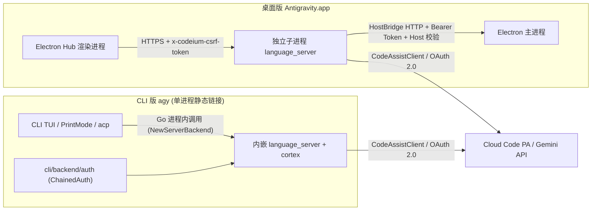

# Antigravity CLI (`agy`) 与桌面端授权及请求链路对比分析

本文结合桌面版还原源码分析（[docs/反重力授权请求.md](file:///Users/mac/antigravity/docs/%E5%8F%8D%E9%87%8D%E5%8A%9B%E6%8E%88%E6%9D%83%E8%AF%B7%E6%B1%82.md)、[`src/remote/signInUrls.ts`](file:///Users/mac/antigravity/src/remote/signInUrls.ts)、[`src/hostBridgeServer.ts`](file:///Users/mac/antigravity/src/hostBridgeServer.ts)、[`src/lsDefaults.ts`](file:///Users/mac/antigravity/src/lsDefaults.ts)）与 CLI 二进制符号及字符串元数据（[jetski-functions.jsonl](file:///Users/mac/antigravity/cli/metadata/jetski-functions.jsonl)、[cli-commands.json](file:///Users/mac/antigravity/cli/metadata/cli-commands.json)），系统梳理 **CLI（`agy` v`1.5.9`）** 与 **桌面端（`Antigravity.app`）** 在授权认证和请求链路上的同源性与差异。

---

## 1. 总结结论

- **云端账号体系与上游业务请求高度同源**：两者内置同一套 Go 引擎（`language_server/auth_client`、`language_server/code_assist_client` 与 `cortex`），连向 Google OAuth 2.0 授权端点与 Cloud Code / Gemini API 的客户端 ID、Scope 与 RPC 请求结构基本一致。
- **本机运行拓扑、无头认证入口与安全边界完全不同**：桌面版由 Electron 壳层做跨进程隔离与浏览器/SSH 安全代理；CLI 则是单进程内直连，并围绕终端/CI/无头环境扩展了 `ChainedAuth` 认证链、`acp --stdio` 与独立本地存储机制。

---

## 2. 同源部分：云端 OAuth 与上游请求客户端

从 `/Users/mac/.local/bin/agy` 的 `__rodata` 字符串与 `gopclntab` 函数表实测验证，以下三部分与桌面版外部 `language_server` 共享同一代码源：

### 2.1 一致的 OAuth 2.0 客户端 ID、端点与 Scope

对照桌面端 [`src/remote/signInUrls.ts`](file:///Users/mac/antigravity/src/remote/signInUrls.ts#L23-L68) 中对远程 `language_server` 登录 URL 的白名单锁定，`/Users/mac/.local/bin/agy` 内存在完全相同的 OAuth 参数：

| 登录类型 | 授权端点 | `client_id`（两端实测一致） | 关键 Scope |
| :--- | :--- | :--- | :--- |
| Google 个人账号 | `https://accounts.google.com/o/oauth2/auth`（及 `/v2/auth`） | `1071006060591-<redacted-consumer-client-id>` | `cloud-platform`、`userinfo.email`、`userinfo.profile`、`cclog`、`experimentsandconfigs` + **`aicode`** |
| Google Cloud 企业账号 | `https://accounts.google.com/o/oauth2/auth`（及 `/v2/auth`） | `884354919052-<redacted-gcp-client-id>` | 同上（不含 `aicode`） |
| Workforce Identity Federation (WIF) | `https://auth.cloud.google/authorize` | CLI 同样支持 `wif_browser.go`（`*wifOAuthMethod`）与 IAM `workforcePools` | `cloud-platform`、`openid`、`email`、`profile`、`offline_access` |

### 2.2 复用的底层 `language_server/auth_client` 获取器

`agy` 直接包含完整的 `third_party/jetski/language_server/auth_client/` 包，提供三类令牌获取器（`acquirer.go`）：
- `(*BrowserTokenAcquirer).AcquireToken`：使用 `listenLoopbackDualStackWith` 同时绑定 IPv4/IPv6 回环端口接收 OAuth 回调，并跳转 `https://antigravity.google/auth-success?app=...`（由 `AuthSuccessAppName` 生成）。
- `(*TerminalTokenAcquirer).AcquireToken`：终端交互式 OAuth 认证。
- `(*OutOfBandTokenAcquirer).AcquireToken`（配合 `shouldUseRemoteOOBAuth` / `SubmitCode` / `exchangeSubmittedAuthCode`）：当检测到远程/无浏览器环境时，打印授权链接并等待用户粘贴授权码换取 Token。

### 2.3 共用的上游模型与配额请求层（`code_assist_client`）

模型推理、配额与实验开关请求在两端均经由 `language_server/code_assist_client`（`aicode.go`）发出，关键方法和默认上游端点如下：
- 推理请求：`(*CodeAssistClient).StreamGenerateContentFromAICode`、`(*CodeAssistClient).GenerateContentFromAICode`（支持 Gemini `/v1beta/models/%s:generateContent` 与 Cloud Code 接口）；
- 配置/许可/配额：`fetchAICodeConfig`、`ListExperimentsFromAICode`、`FetchLicensesFromAICode`、`FetchQuotaStatusFromAICode`；
- 默认端点：与桌面端 [`src/lsDefaults.ts`](file:///Users/mac/antigravity/src/lsDefaults.ts#L3-L4) 一致，默认对接 `https://daily-cloudcode-pa.googleapis.com`（参见 `agy acp --help` 中 `--cloud_code_endpoint` 默认值）、`https://cloudcode-pa.googleapis.com` 与 `https://generativelanguage.googleapis.com`。

---

## 3. 核心差异：4 个本地链路与安全边界区别

### 3.1 本地通信链路：跨进程 HTTPS/CSRF vs 进程内直连

- **桌面版（双进程 + 双隔离令牌）**：
  - 渲染进程（`https://127.0.0.1:<port>/`）与主进程调用外部 `language_server` 时，走本地 HTTPS ConnectRPC，必须携带 `--csrf_token` 对应的 **`x-codeium-csrf-token`** 请求头，主进程用 `setupLocalCertTrust()` 仅信任 `127.0.0.1` / `localhost` 的自签名证书；
  - 外部 `language_server` 反向触发主进程更新时，访问 [`src/hostBridgeServer.ts`](file:///Users/mac/antigravity/src/hostBridgeServer.ts#L114-L164) 暴露的 `127.0.0.1:<port>` 服务，并强制执行三层门禁（`remoteAddress` 回环检查、`Host` 头防 DNS Rebinding、32 字节 `Authorization: Bearer <token>` 常量时间比对）。
- **CLI 版（单进程内置后端 / ACP stdio）**：
  - `third_party/jetski/cli/backend/language_server.go` 中仅包含 `backend.unsupported`（`208 B`），CLI 默认**不再启动外部 `language_server` 子进程**，而是由 `cli/backend/server.go` 的 `NewServerBackend` 在同一个 Go 进程内直连内嵌的 `language_server` 与 `cortex`，因此不需要桌面端主进程到 LS 的 HTTPS + `x-codeium-csrf-token` 环回调用链。
  - 当通过 `agy acp` 接入外部编辑器时，对宿主走 **`--stdio` JSON-RPC**（可选 `--process-per-session` 为每个会话隔离 `--worker` 子进程），认证由 `cli/acp/acpauth` 负责；此外内部也保留了 `exa.host_bridge_pb.HostBridgeService` 的 Protobuf 兼容接口。

### 3.2 本地认证入口：CLI 专有的 `ChainedAuth` 多级认证链

桌面版默认面向有系统浏览器的 GUI 用户；CLI 在 `third_party/jetski/cli/backend/auth/`（11 个源文件、91 个函数）外层实现了面向终端和自动化场景的 `ChainedAuth`（`(*ServerBackendConfig).chainedAuthOrDefault`）：

| 认证实现 | 对应 Go 文件 | 作用 |
| :--- | :--- | :--- |
| `geminiAPIKeyAuth` | `gemini_api_key.go` | 读取 `GEMINI_API_KEY` 环境变量，支持完全无头运行（`-p` 模式） |
| `gatewayAuth` | `gateway.go` | 对接自定义 API Gateway 代理或企业网关鉴权 |
| `adcAuth` | `adc_auth.go` | 自动探测 Google Cloud Application Default Credentials（`TryAuth` / `fetchAdcUserInfo`） |
| `keyringAuth` + `cliFileTokenStorage` | `keyring.go` / `token_storage.go` | 系统钥匙串与 CLI 本地文件令牌缓存（`NewCLITokenStorage`、`SaveToken`、`LoadStoredToken`、`SaveUserTier`、`SaveProjectAndRegion`），配合 `validate.go` (`ValidateStoredToken`) 校验有效性 |
| `oauthMethod` | `browser.go` | 本地回环 OAuth 浏览器登录、Token 持久化（`savingTokenSource`）与 `RunLogin` / `refreshAndSaveStoredToken`（`cde_login.go`） |
| `wifOAuthMethod` | `wif_browser.go` | 浏览器 Workforce Identity Federation 登录与手动授权码提交（`SubmitAuthorizationCode`） |
| `externalCorpLoginAuth` | `corplogin_external.go` | 外部构建版中为 `16 B` 空占位实现 |

在 ACP 模式下，`third_party/jetski/cli/acp/acpauth/` 还额外提供 `ResolveVertexConfig`、`ResolveAdminGatewayDisposition`、`loadMDMAdminSettings` 等配置解析与 OAuth loopback 登录支持。

### 3.3 远程会话与防劫持安全中继

- **桌面版**：
  - 使用 `antigravity://` 自定义 Deep Link 接收回调（限定仅投递给本地 Hub 窗口）；
  - 连接 SSH 远端时，Electron 为隔离分区配置 `socks5://127.0.0.1:<port>`（带 `<-loopback>`），并在本机同时独占监听 `127.0.0.1:P` 与 `[::1]:P`，校验 `/auth/callback` 的唯一 `state` 后再经 SSH 隧道单次转发给远端 LS，并对弹窗 URL 做白名单（`classifyOpenUrl`）与限流防抖。
- **CLI 版**：
  - 没有 Electron Deep Link 与 Chromium `socks5` 分区隧道；
  - 在 SSH 远程终端下依赖 `authclient` 自动切换 `OutOfBandTokenAcquirer`（OOB 链接 + 授权码）；
  - 当使用 `--remote-agent` 或 `agy remote-control` 时，后端走 `cli/backend/server_cloud.go`（`EnsureCloudProject`、`WarmUpCloudEnvironment`）以及 `language_server/remotecontrol` + `exa.remoting.RemotingService`（信令/WebRTC 通道）。

### 3.4 状态目录与内置浏览器中间层

- **数据目录隔离**：桌面版默认通过 `--app_data_dir` 存入 `~/.gemini/antigravity/`；CLI 的 `--app-data-dir` 默认值为 `antigravity-cli`（即 `~/.gemini/antigravity-cli/`，存放 `settings.json`、`hooks.json`、`cache/projects.json` 等），并与 `~/.gemini/` 共享 Skills、MCP 与部分插件配置。
- **浏览器凭据剥离**：桌面版主进程额外为内置 `<webview>` 实现 `guestRequestHeaders`、`guestCrossSiteCredentials`（跨站子帧剥离 `Cookie`/`Authorization`）、`plugin://` 协议转发与 BeyondCorp PAC 探测；CLI 无 Electron 渲染容器，不走这条 `<webview>` 请求改写管道。

---

## 4. 一览对照表

| 环节 | 桌面版（`Antigravity.app`） | CLI 版（`agy`） |
| :--- | :--- | :--- |
| **前端 ↔ 引擎通信** | Electron ↔ 外部 `language_server`（HTTPS + `x-codeium-csrf-token`） | Go 进程内直连 `NewServerBackend`（ACP 模式对外走 `stdio JSON-RPC`） |
| **反向宿主控制** | `HostBridgeServer`（`127.0.0.1` + `Host` + Bearer Token） | 进程内直接处理（仅保留 `HostBridgeService` 协议类型） |
| **交互 OAuth 登录** | `auth_client`（Google 个人 / 企业 / WIF）+ Deep Link / LS stdout | 同一套 `auth_client` 个人 / 企业 / WIF + `cli/backend/auth` 回环与 OOB |
| **无头 / 密钥认证** | 主要依靠已登录会话或外部 LS 配置 | `ChainedAuth`：`GEMINI_API_KEY`、`ADC`、`Gateway`、`Keyring`/文件令牌 |
| **远程会话链路** | SSH `socks5` 分区 + 单次 `state` `/auth/callback` 中继 | 终端 OOB 登录 + `server_cloud` / `RemotingService` 远程代理 |
| **上游 AI 请求** | `CodeAssistClient` → `daily-cloudcode-pa` / `generativelanguage` | 同一套 `CodeAssistClient` → `daily-cloudcode-pa` / `generativelanguage` |
| **默认状态目录** | `~/.gemini/<appDataDir>`（如 `antigravity`） | `~/.gemini/antigravity-cli`（可通过 `--app-data-dir` 覆盖） |
